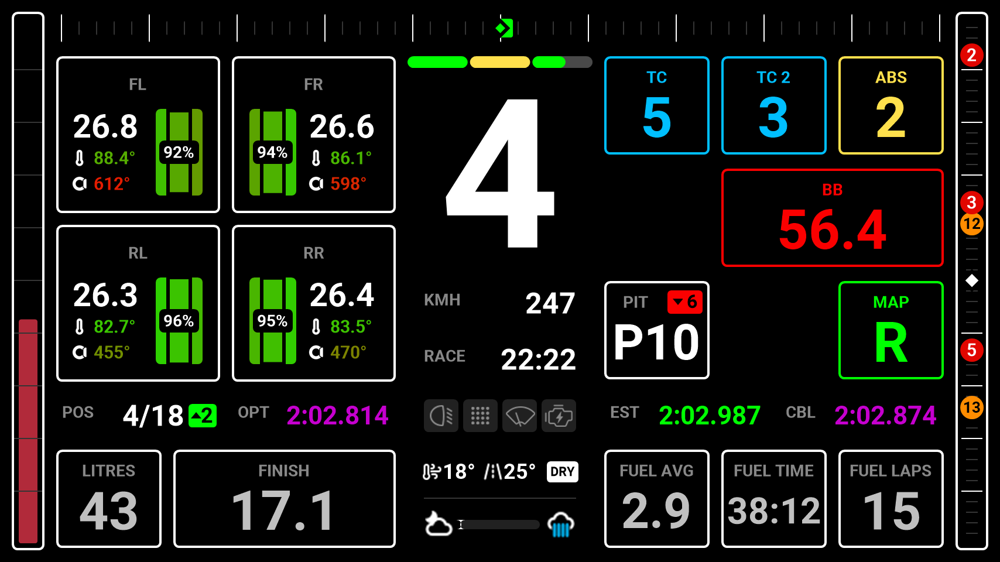
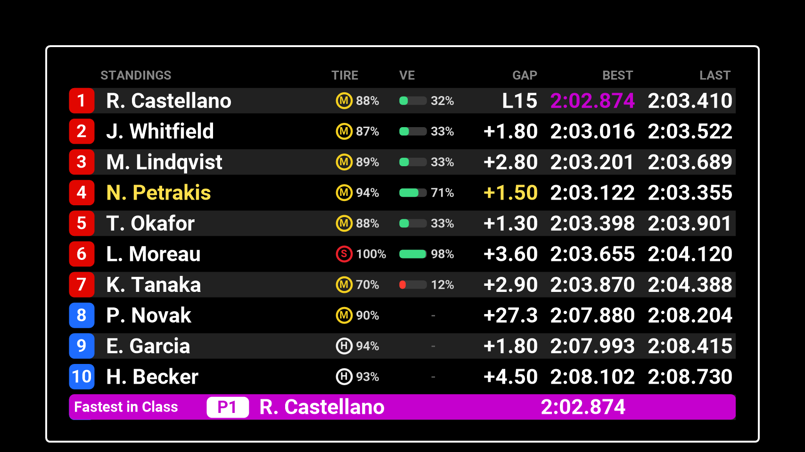
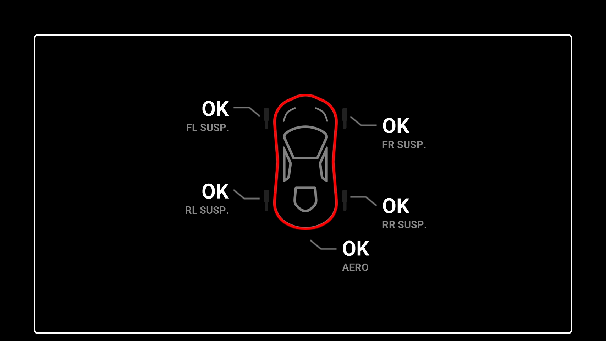
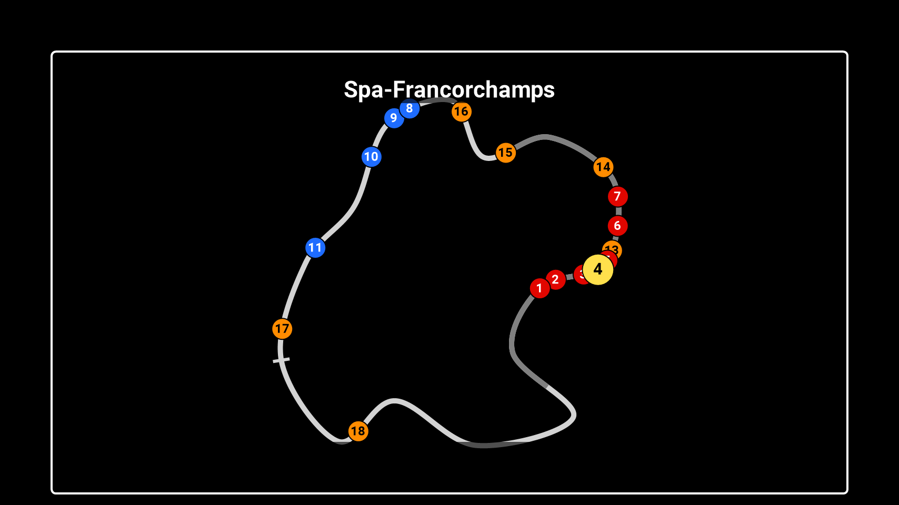
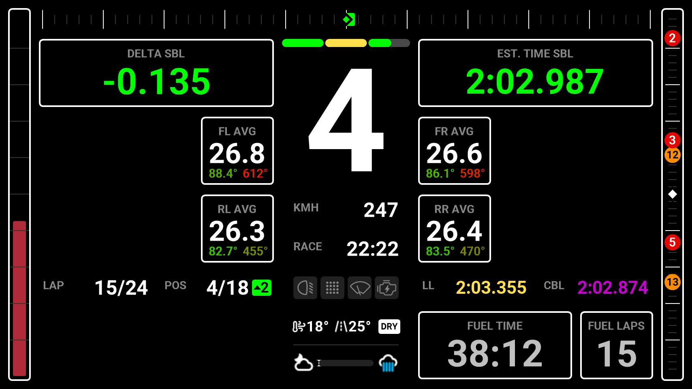
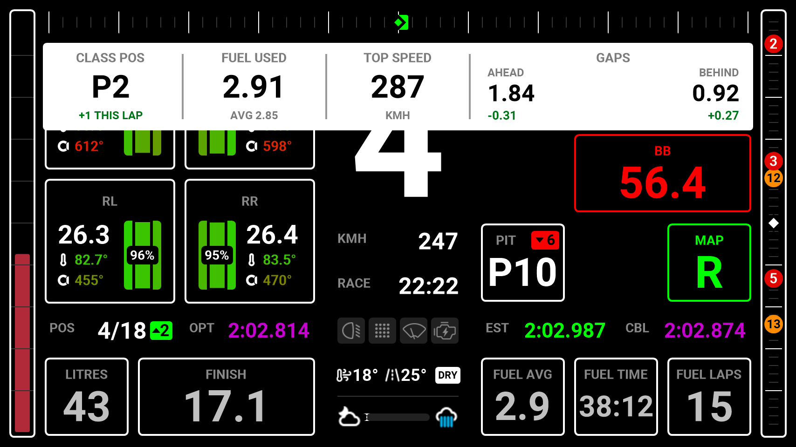

<!-- Made by scripts/Build-Readmes.ps1 from info.json and dash-pro-default.dashpro: change those, not this file -->
[← All presets](../../README.md)

# Dash Pro Default

The pages and layouts Lovely Dashboard Pro comes with: tyres, TC and ABS on the main page, full screen standings, damage and track map, and a qualifying page with delta, estimated lap and average tyre temperatures.

| | |
| --- | --- |
| **Author** | Lovely Sim Racing |
| **Tags** | `Official` `Default` `Lovely Sim Racing` `Lovely Dashboard` `All Sims` `16:9` |
| **Pages** | 5: Primary, Leaderboard, Damage, Map, Quali |
| **Added** | 2026-10-24 |
| **Updated** | 2026-11-09 |
| **Preset format** | v1 |

## Import
In the Lovely Plugin, open **Dash Pro**, click **Browse Presets**, pick **Dash Pro Default** and click **Import**.

Or download [dash-pro-default.dashpro](dash-pro-default.dashpro), then click **Import** at the top right of the Dash Pro page and choose the file.

Importing replaces the pages and layouts, the Lap Review and the Alerts & Notifications settings of the level you have selected: All Devices, a device, a sim, a class or a vehicle.

## Pages

### 1. Primary

| | |
| --- | --- |
| **Layout** | Modular |
| **Sessions** | Practice, Race |
| **Topbar** | Delta |
| **Sidebars** | Fuel (left), Linear Map (right) |
| **Left modules** | 2 x 2: Tire Front Left, Tire Front Right / Tire Rear Left, Tire Rear Right |
| **Right modules** | 3 x 3: TC, TC 2, ABS / Brake Bias / Pit Loss, Engine Map |
| **Central column** | Speed, Time Remaining, Functions, Weather · sector bar |
| **Bottom left** | Fuel, Refuel |
| **Bottom right** | Fuel Average, Fuel Time Left, Fuel Laps Left |
| **Data row** | Position, Optimal Best Lap, Estimated Lap, Class Session Best |

### 2. Leaderboard

| | |
| --- | --- |
| **Layout** | Full Screen: Standings |
| **Sessions** | Practice, Race |
| **Topbar** | Next Race |

### 3. Damage

| | |
| --- | --- |
| **Layout** | Full Screen: Damage |
| **Sessions** | Practice, Race |
| **Topbar** | Next Race |

### 4. Map

| | |
| --- | --- |
| **Layout** | Full Screen: Map Static |
| **Sessions** | Practice, Race |
| **Topbar** | Next Race |

### 5. Quali

| | |
| --- | --- |
| **Layout** | Modular |
| **Sessions** | Practice, Qualifying |
| **Topbar** | Delta |
| **Sidebars** | Fuel (left), Linear Map (right) |
| **Left modules** | 3 x 3: Delta / Tire Front Left AVG / Tire Rear Left AVG |
| **Right modules** | 3 x 3: Estimated Lap / Tire Front Right AVG / Tire Rear Right AVG |
| **Central column** | Speed, Time Remaining, Functions, Weather · sector bar |
| **Bottom right** | Fuel Time Left, Fuel Laps Left |
| **Data row** | Lap, Position, Last Lap, Class Session Best |

## Lap Review

| | |
| --- | --- |
| **Sessions** | Practice, Qualifying, Race |
| **Practice** | Strip 1-1-1-2: Position, Lap Time, Lap Delta, Sector Deltas |
| **Qualifying** | Strip 1-1-1-2: Position, Lap Time, Lap Delta, Sector Deltas |
| **Race** | Strip 1-1-1-2: Position, Fuel Used, Top Speed, Gaps |
| **Shows** | 3.5 s after each lap, normal colours |

## Alerts & Notifications
| Alert | Shown as |
| --- | --- |
| Vehicle Settings | Full Screen, inverted, 1 s |
| Rotary Dials | Full Screen, normal colours |
| Pit Limiter | Small, normal colours |
| Engine & Ignition | Small, normal colours |
| Launch Mode | Off |
| Lift Now | Strip, normal colours |
| Fuel Warnings | Fuel blinks at 4 laps, LOW FUEL at 2 laps, PIT NOW |
| Engine Warnings | Water temperature (110°), oil temperature (130°), oil pressure, fuel pressure |
| Penalty | On |
| Flags | On |
| Damage | Strip, 7.5 s |

---

Screenshots: the 854x480 Lovely Dashboard Pro with sample race data (Le Mans Ultimate at Spa). Shared under [CC BY-NC-SA 4.0](https://creativecommons.org/licenses/by-nc-sa/4.0/).
