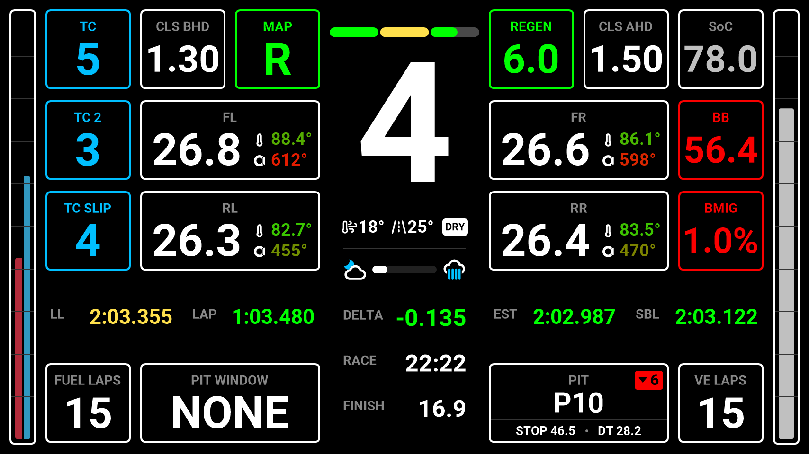
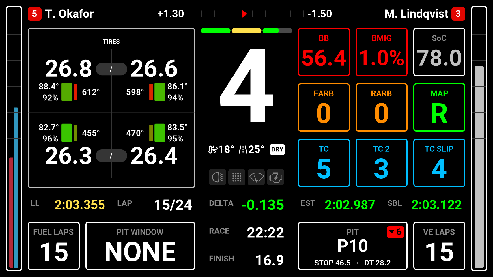
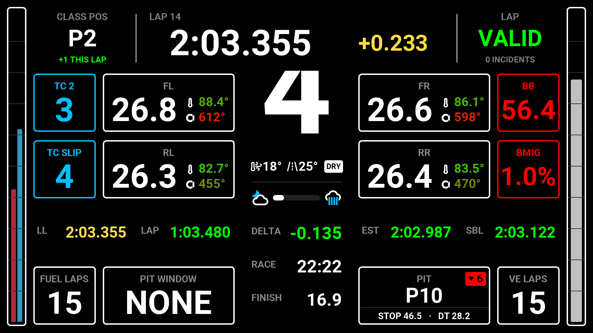

<!-- Made by scripts/Build-Readmes.ps1 from info.json and hypercar-endurance-lmu-jrg.dashpro: change those, not this file -->
[← All presets](../../README.md)

# Hypercar Endurance LMU JRG

For LMU Hypercars, on two pages used in every session, with no separate qualifying page: the main page has TC, the class gaps and the tyres on the left, regen, SoC, brake bias and migration on the right, and fuel, VE and pit loss along the bottom; the second page swaps in a large multifunction panel on the left (tyres) and the car's settings on the right.

| | |
| --- | --- |
| **Author** | JRG Racing |
| **Tags** | `LMU` `Hypercar` `16:9` |
| **Pages** | 2: JRG LMU Hyper Main, JRG Hyper MFM P2 |
| **Added** | 2026-11-20 |
| **Updated** | 2026-11-20 |
| **Preset format** | v1 |

## Import
In the Lovely Plugin, open **Dash Pro**, click **Browse Presets**, pick **Hypercar Endurance LMU JRG** and click **Import**.

Or download [hypercar-endurance-lmu-jrg.dashpro](hypercar-endurance-lmu-jrg.dashpro), then click **Import** at the top right of the Dash Pro page and choose the file.

Importing replaces the pages and layouts, the Lap Review and the Alerts & Notifications settings of the level you have selected: All Devices, a device, a sim, a class or a vehicle.

## Pages

### 1. JRG LMU Hyper Main

| | |
| --- | --- |
| **Layout** | Modular |
| **Sessions** | Practice, Qualifying, Race |
| **Sidebars** | Fuel / VE (left), SoC (right) |
| **Left modules** | 3 x 3: TC, Class Behind, Engine Map / TC 2, Tire Front Left / TC Slip, Tire Rear Left |
| **Right modules** | 3 x 3: Regen, Class Ahead, SoC / Tire Front Right, Brake Bias / Tire Rear Right, Brake Migration |
| **Central column** | Weather, Delta, Time Remaining, Refuel · sector bar |
| **Bottom left** | Fuel Laps Left, Pit Window |
| **Bottom right** | Pit Loss, VE Laps Left |
| **Data row** | Last Lap, Current Lap, Estimated Lap, Session Best |

### 2. JRG Hyper MFM P2

| | |
| --- | --- |
| **Layout** | Modular |
| **Sessions** | Practice, Qualifying, Race |
| **Topbar** | Class Gaps |
| **Sidebars** | Fuel / VE (left), SoC (right) |
| **Left modules** | Multifunction Modules (the pages set in the plugin) |
| **Right modules** | 3 x 3: Brake Bias, Brake Migration, SoC / Front Roll Bar, Rear Roll Bar, Engine Map / TC, TC 2, TC Slip |
| **Central column** | Weather, Functions, Delta, Time Remaining, Refuel · sector bar |
| **Bottom left** | Fuel Laps Left, Pit Window |
| **Bottom right** | Pit Loss, VE Laps Left |
| **Data row** | Last Lap, Lap, Estimated Lap, Session Best |

## Lap Review

| | |
| --- | --- |
| **Sessions** | Practice, Qualifying, Race |
| **Layout** | Strip 1-3-1: Position, Lap Time, Lap Validity |
| **Shows** | 3.5 s after each lap, inverted |

## Alerts & Notifications
| Alert | Shown as |
| --- | --- |
| Vehicle Settings | Strip, inverted, 1 s |
| Rotary Dials | Full Screen, normal colours |
| Pit Limiter | Small, inverted |
| Engine & Ignition | Small, inverted |
| Launch Mode | Off |
| Lift Now | Strip, normal colours |
| Fuel Warnings | Fuel blinks at 4 laps, LOW FUEL at 2 laps, PIT NOW |
| Engine Warnings | Water temperature (110°), oil temperature (130°), oil pressure, fuel pressure |
| Penalty | On |
| Flags | On |
| Damage | Block, 5 s |

---

Screenshots: the 854x480 Lovely Dashboard Pro with sample race data (Le Mans Ultimate at Spa). Shared under [CC BY-NC-SA 4.0](https://creativecommons.org/licenses/by-nc-sa/4.0/).
