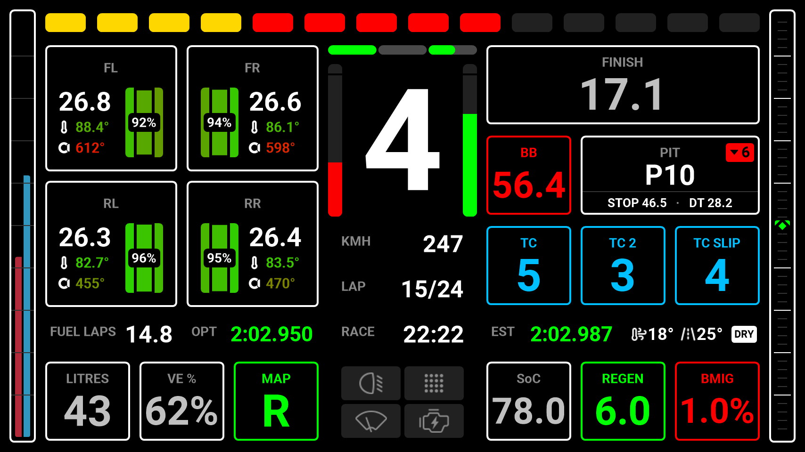
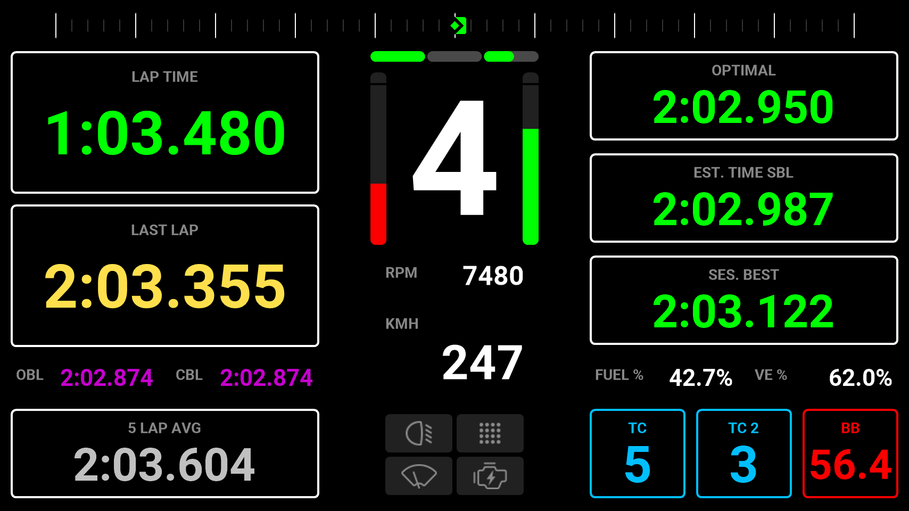
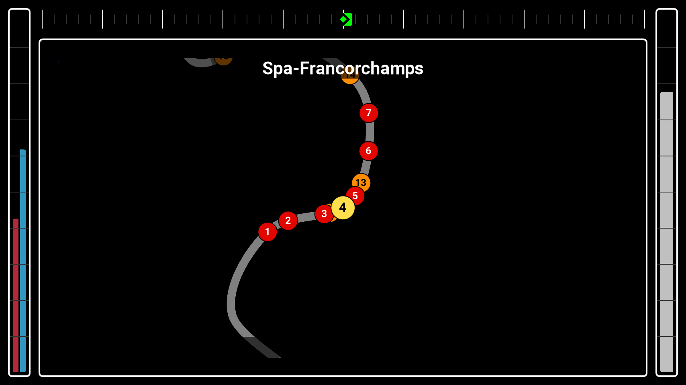
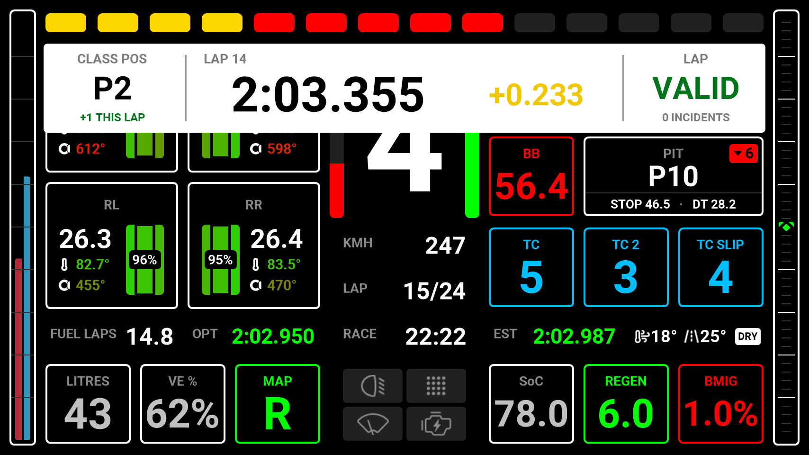

<!-- Made by scripts/Build-Readmes.ps1 from info.json and hypercar-endurance-lmu.dashpro: change those, not this file -->
[← All presets](../../README.md)

# Hypercar Endurance LMU

Made for Hypercar endurance races in Le Mans Ultimate, with everything Team Hellas Vision Racing uses in long races: a main page for practice and the race, a qualifying page and a full screen track map. No extra plugins needed.

| | |
| --- | --- |
| **Author** | George Margetis-HVT |
| **Tags** | `LMU` `Hypercar` `Endurance` `16:9` |
| **Pages** | 3: Marge's Main, Qualifying, Map |
| **Added** | 2026-11-11 |
| **Updated** | 2026-11-13 |
| **Preset format** | v1 |

## Import
In the Lovely Plugin, open **Dash Pro**, click **Browse Presets**, pick **Hypercar Endurance LMU** and click **Import**.

Or download [hypercar-endurance-lmu.dashpro](hypercar-endurance-lmu.dashpro), then click **Import** at the top right of the Dash Pro page and choose the file.

Importing replaces the pages and layouts, the Lap Review and the Alerts & Notifications settings of the level you have selected: All Devices, a device, a sim, a class or a vehicle.

## Pages

### 1. Marge's Main

| | |
| --- | --- |
| **Layout** | Modular |
| **Sessions** | Practice, Race |
| **Topbar** | Virtual RPM |
| **Sidebars** | Fuel / VE (left), Delta (right) |
| **Left modules** | 2 x 2: Tire Front Left, Tire Front Right / Tire Rear Left, Tire Rear Right |
| **Right modules** | 3 x 3: Refuel / Brake Bias, Pit Loss / TC, TC 2, TC Slip |
| **Central column** | Speed, Lap, Time Remaining, Functions · Inputs · sector bar |
| **Bottom left** | Fuel, VE %, Engine Map |
| **Bottom right** | SoC, Regen, Brake Migration |
| **Data row** | Fuel Laps Left, Optimal Best Lap, Estimated Lap, Weather |

### 2. Qualifying

| | |
| --- | --- |
| **Layout** | Modular |
| **Sessions** | Practice, Qualifying |
| **Topbar** | Delta |
| **Left modules** | 2 x 2: Current Lap / Last Lap |
| **Right modules** | 3 x 3: Optimal Best Lap / Estimated Lap / Session Best |
| **Central column** | RPM, Speed, Functions · Inputs · sector bar |
| **Bottom left** | 5 Lap Average |
| **Bottom right** | TC, TC 2, Brake Bias |
| **Data row** | Overall Session Best, Class Session Best, Fuel %, VE % |

### 3. Map

| | |
| --- | --- |
| **Layout** | Full Screen: Map Animated |
| **Sessions** | Practice, Race |
| **Topbar** | Delta |
| **Sidebars** | Fuel / VE (left), SoC (right) |

## Lap Review

| | |
| --- | --- |
| **Sessions** | Practice, Qualifying, Race |
| **Practice** | Full Screen: Sectors band / Position, Sector Deltas, Lap Validity |
| **Qualifying** | Strip 1-3-1: Position, Lap Time, Lap Validity |
| **Race** | Strip 1-3-1: Position, Lap Time, Lap Validity |
| **Shows** | 3.5 s after each lap, normal colours |

## Alerts & Notifications
| Alert | Shown as |
| --- | --- |
| Vehicle Settings | Strip, inverted, 1 s |
| Rotary Dials | Full Screen, normal colours |
| Pit Limiter | Small, normal colours |
| Engine & Ignition | Full Screen, inverted |
| Launch Mode | Off |
| Lift Now | Strip, normal colours |
| Fuel Warnings | Fuel blinks at 4 laps, LOW FUEL at 2 laps, PIT NOW |
| Engine Warnings | Water temperature (110°), oil temperature (130°), oil pressure, fuel pressure |
| Penalty | On |
| Flags | On |
| Damage | Block, 5 s |

---

Screenshots: the 854x480 Lovely Dashboard Pro with sample race data (Le Mans Ultimate at Spa). Shared under [CC BY-NC-SA 4.0](https://creativecommons.org/licenses/by-nc-sa/4.0/).
