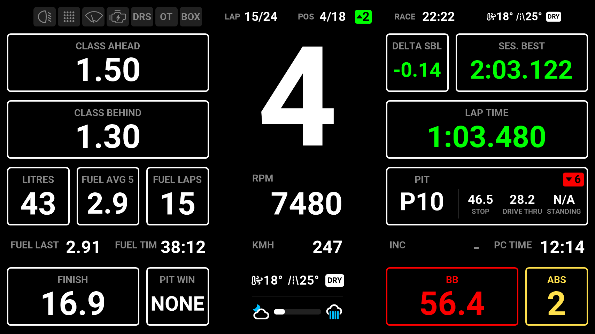
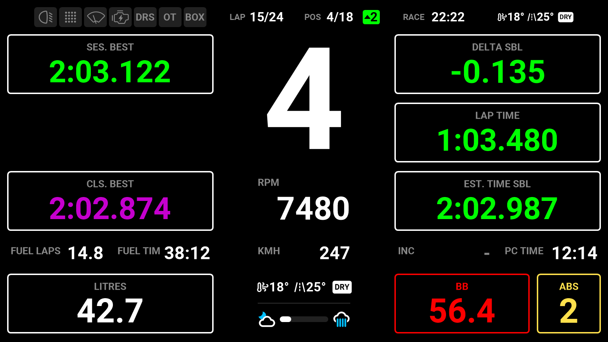
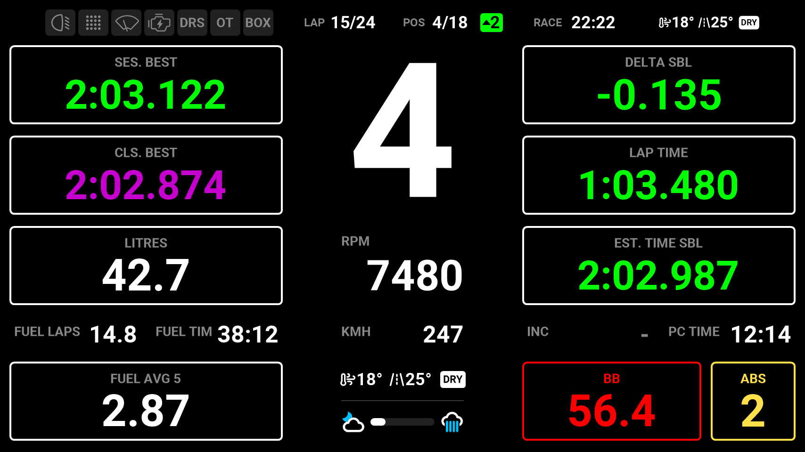
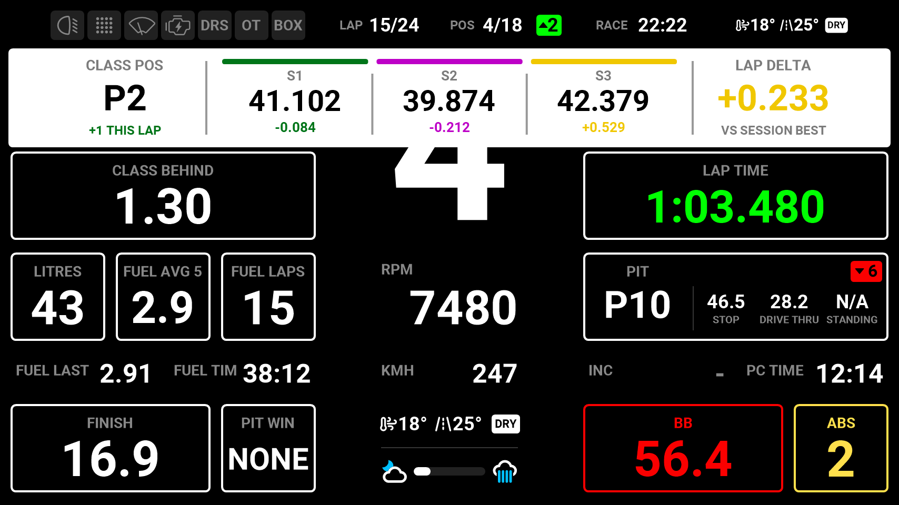

<!-- Made by scripts/Build-Readmes.ps1 from info.json and iracing-tcr-dash.dashpro: change those, not this file -->
[← All presets](../../README.md)

# iRacing TCR Dash

For iRacing's TCR class, with a page for each session that follows your own class in multiclass races. The race page has the gaps to the class cars ahead and behind, fuel use, the pit window and pit loss; qualifying is all about lap times, with the session and class bests; practice keeps the lap times and fuel use in view. RPM and speed in the centre, brake bias and ABS at the bottom right.

| | |
| --- | --- |
| **Author** | Chris Indeherberge |
| **Tags** | `iRacing` `TCR` `Endurance` `Multiclass` `16:9` |
| **Pages** | 3: Primary, Qualification, Practice |
| **Added** | 2026-11-24 |
| **Updated** | 2026-11-24 |
| **Preset format** | v1 |

## Import
In the Lovely Plugin, open **Dash Pro**, click **Browse Presets**, pick **iRacing TCR Dash** and click **Import**.

Or download [iracing-tcr-dash.dashpro](iracing-tcr-dash.dashpro), then click **Import** at the top right of the Dash Pro page and choose the file.

Importing replaces the pages and layouts, the Lap Review and the Alerts & Notifications settings of the level you have selected: All Devices, a device, a sim, a class or a vehicle.

## Pages

### 1. Primary

| | |
| --- | --- |
| **Layout** | Modular |
| **Sessions** | Race |
| **Topbar** | Utility Bar |
| **Left modules** | 3 x 3: Class Ahead / Class Behind / Fuel, Fuel 5 Lap Average, Fuel Laps Left |
| **Right modules** | 3 x 3: Delta, Session Best / Current Lap / Pit Loss |
| **Central column** | RPM, Speed, Weather |
| **Bottom left** | Refuel, Pit Window |
| **Bottom right** | Brake Bias, ABS |
| **Data row** | Fuel Last Lap, Fuel Time Left, Incidents, PC Time |

### 2. Qualification

| | |
| --- | --- |
| **Layout** | Modular |
| **Sessions** | Qualifying |
| **Topbar** | Utility Bar |
| **Left modules** | 3 x 3: Session Best / Class Session Best |
| **Right modules** | 3 x 3: Delta / Current Lap / Estimated Lap |
| **Central column** | RPM, Speed, Weather |
| **Bottom left** | Fuel |
| **Bottom right** | Brake Bias, ABS |
| **Data row** | Fuel Laps Left, Fuel Time Left, Incidents, PC Time |

### 3. Practice

| | |
| --- | --- |
| **Layout** | Modular |
| **Sessions** | Practice |
| **Topbar** | Utility Bar |
| **Left modules** | 3 x 3: Session Best / Class Session Best / Fuel |
| **Right modules** | 3 x 3: Delta / Current Lap / Estimated Lap |
| **Central column** | RPM, Speed, Weather |
| **Bottom left** | Fuel 5 Lap Average |
| **Bottom right** | Brake Bias, ABS |
| **Data row** | Fuel Laps Left, Fuel Time Left, Incidents, PC Time |

## Lap Review

| | |
| --- | --- |
| **Sessions** | Practice, Qualifying |
| **Layout** | Strip 1-3-1: Position, Sectors, Lap Delta |
| **Shows** | 3.5 s after each lap, normal colours |

## Alerts & Notifications
| Alert | Shown as |
| --- | --- |
| Vehicle Settings | Strip, normal colours, 1 s |
| Rotary Dials | Full Screen, normal colours |
| Pit Limiter | Small, normal colours |
| Engine & Ignition | Small, normal colours |
| Launch Mode | Off |
| Lift Now | Off |
| Fuel Warnings | Fuel blinks at 4 laps, LOW FUEL at 2 laps, PIT NOW |
| Engine Warnings | Water temperature (110°), oil temperature (130°), oil pressure, fuel pressure |
| Penalty | On |
| Flags | On |
| Damage | Block, 7.5 s |

---

Screenshots: the 854x480 Lovely Dashboard Pro with sample race data (Le Mans Ultimate at Spa). Shared under [CC BY-NC-SA 4.0](https://creativecommons.org/licenses/by-nc-sa/4.0/).
