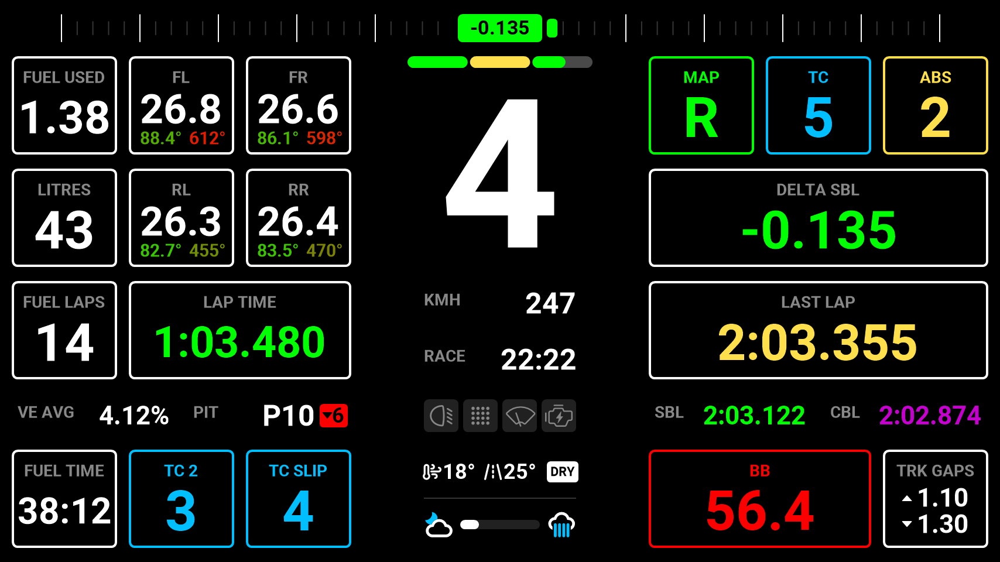
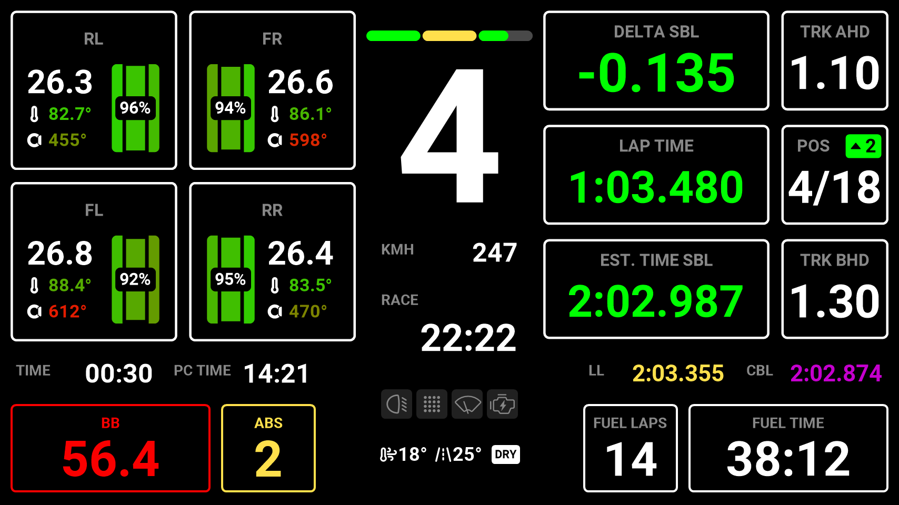
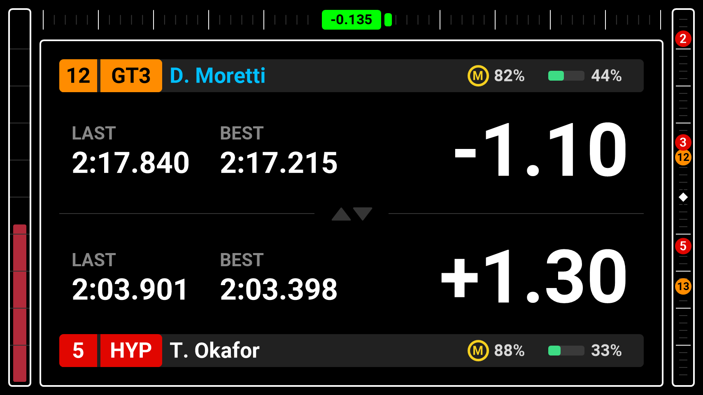
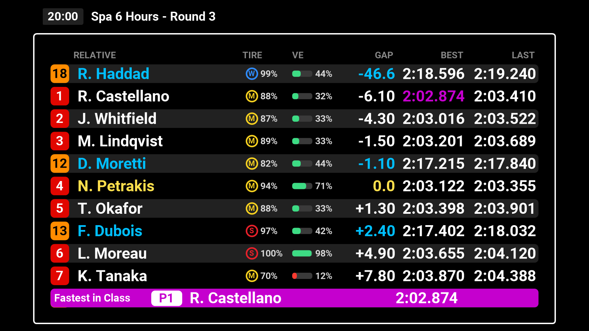
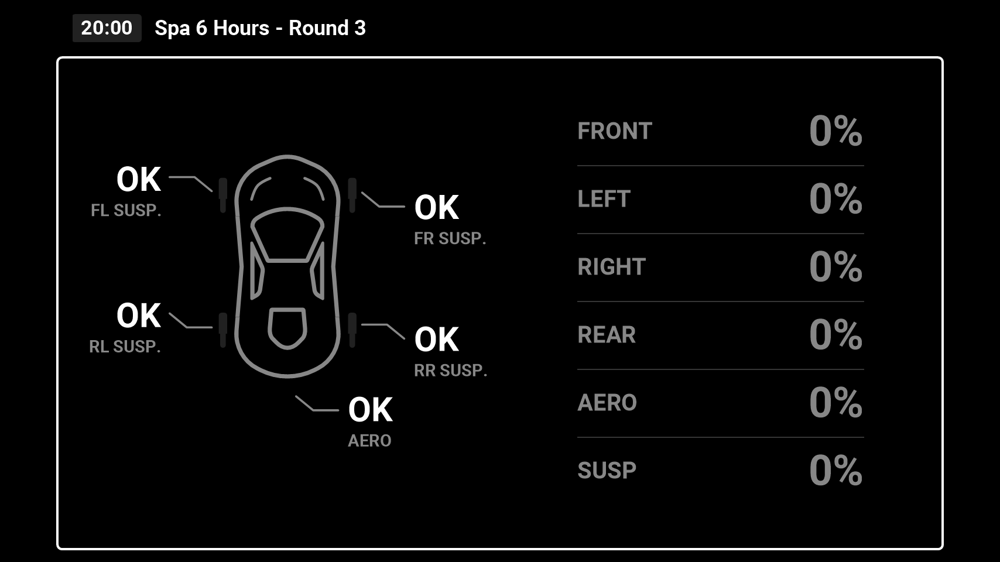
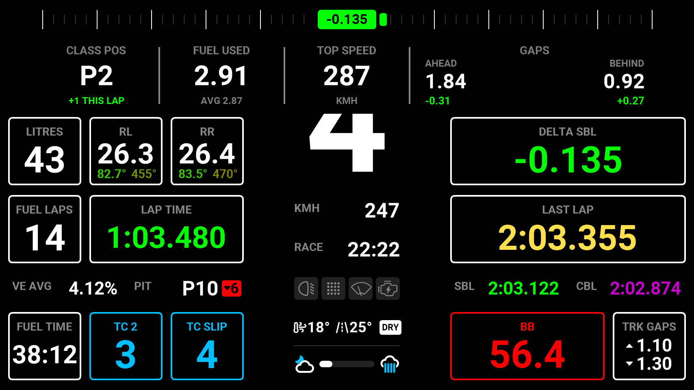

<!-- Made by scripts/Build-Readmes.ps1 from info.json and lmu-gt3-bmw-style.dashpro: change those, not this file -->
[← All presets](../../README.md)

# LMU GT3 BMW Style

For LMU GT3 cars, with a Race page, a Quali page for practice and qualifying, and full-screen Track Opponents, Relative and Damage pages. The race page has fuel this lap, laps and time left, the tires, engine map, TC, ABS and brake bias, the delta and track gaps; the quali page has the delta, estimated lap, all-time best and the cars ahead and behind.

| | |
| --- | --- |
| **Author** | Ntimfo |
| **Tags** | `LMU` `GT3` `BMW M4` `16:9` |
| **Pages** | 5: Race, Quali, Track Opponents, Relative, Damage |
| **Added** | 2026-11-27 |
| **Updated** | 2026-11-27 |
| **Preset format** | v1 |

## Import
In the Lovely Plugin, open **Dash Pro**, click **Browse Presets**, pick **LMU GT3 BMW Style** and click **Import**.

Or download [lmu-gt3-bmw-style.dashpro](lmu-gt3-bmw-style.dashpro), then click **Import** at the top right of the Dash Pro page and choose the file.

Importing replaces the pages and layouts, the Lap Review and the Alerts & Notifications settings of the level you have selected: All Devices, a device, a sim, a class or a vehicle.

## Pages

### 1. Race

| | |
| --- | --- |
| **Layout** | Modular |
| **Sessions** | Race |
| **Topbar** | Delta |
| **Left modules** | 3 x 3: Fuel This Lap, Tire Front Left, Tire Front Right / Fuel, Tire Rear Left, Tire Rear Right / Fuel Laps Left, Current Lap |
| **Right modules** | 3 x 3: Engine Map, TC, ABS / Delta / Last Lap |
| **Central column** | Speed, Time Remaining, Functions, Weather · sector bar |
| **Bottom left** | Fuel Time Left, TC 2, TC Slip |
| **Bottom right** | Brake Bias, Track Gaps |
| **Data row** | VE Average, Pit Loss, Session Best, Class Session Best |

### 2. Quali

| | |
| --- | --- |
| **Layout** | Modular |
| **Sessions** | Practice, Qualifying |
| **Left modules** | 2 x 2: Tire Rear Left, Tire Front Right / Tire Front Left, Tire Rear Right |
| **Right modules** | 3 x 3: Delta, Track Ahead / Current Lap, Position / Estimated Lap, Track Behind |
| **Central column** | Speed, Time Remaining, Functions, Weather · sector bar |
| **Bottom left** | Brake Bias, ABS |
| **Bottom right** | Fuel Laps Left, Fuel Time Left |
| **Data row** | Session Time, PC Time, Last Lap, Class Session Best |

### 3. Track Opponents

| | |
| --- | --- |
| **Layout** | Full Screen: Track Opponents |
| **Sessions** | Practice, Qualifying, Race |
| **Topbar** | Delta |
| **Sidebars** | Fuel (left), Linear Map (right) |

### 4. Relative

| | |
| --- | --- |
| **Layout** | Full Screen: Relative |
| **Sessions** | Practice, Race |
| **Topbar** | Next Race |

### 5. Damage

| | |
| --- | --- |
| **Layout** | Full Screen: Damage |
| **Sessions** | Practice, Race |
| **Topbar** | Next Race |

## Lap Review

| | |
| --- | --- |
| **Sessions** | Practice, Qualifying, Race |
| **Practice** | Full Screen: Sectors band / Tire Wear, Fuel Used, Top Speed |
| **Qualifying** | Strip 1-1-1-2: Position, Lap Time, Lap Delta, Sector Deltas |
| **Race** | Strip 1-1-1-2: Position, Fuel Used, Top Speed, Gaps |
| **Shows** | 3.5 s after each lap, inverted |

## Alerts & Notifications
| Alert | Shown as |
| --- | --- |
| Vehicle Settings | Strip, normal colours, 1 s |
| Rotary Dials | Strip, normal colours |
| Pit Limiter | Small, normal colours |
| Engine & Ignition | Small, normal colours |
| Launch Mode | Off |
| Lift Now | Strip, normal colours |
| Fuel Warnings | Fuel blinks at 4 laps, LOW FUEL at 2 laps, PIT NOW |
| Engine Warnings | Water temperature (110°), oil temperature (130°), oil pressure, fuel pressure |
| Penalty | Off |
| Flags | On |
| Damage | Strip, 5 s |

---

Screenshots: the 854x480 Lovely Dashboard Pro with sample race data (Le Mans Ultimate at Spa). Shared under [CC BY-NC-SA 4.0](https://creativecommons.org/licenses/by-nc-sa/4.0/).
