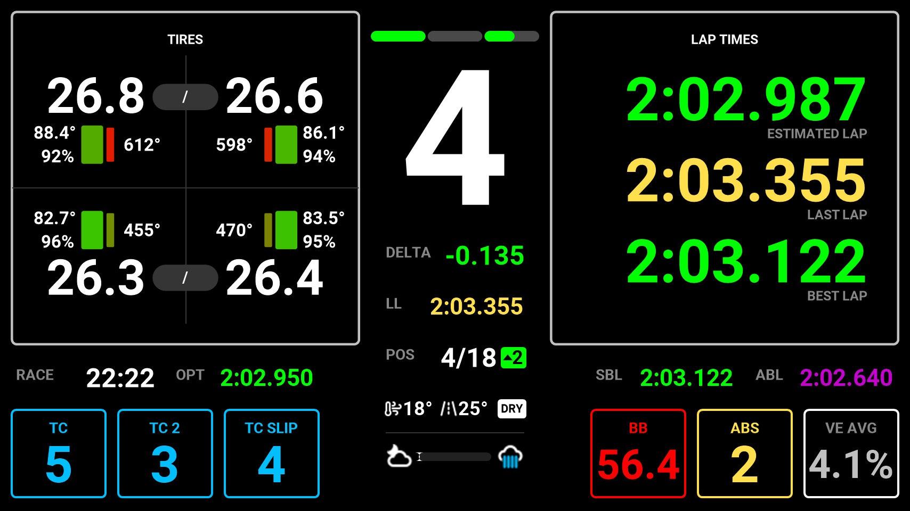
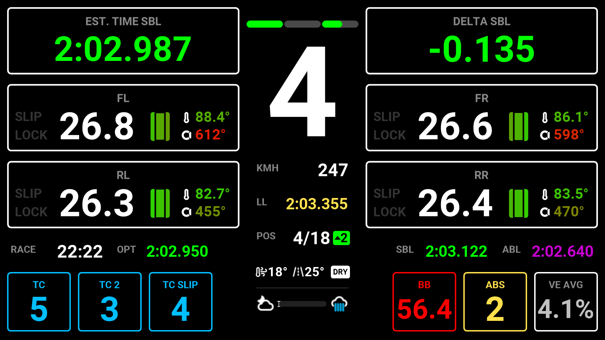
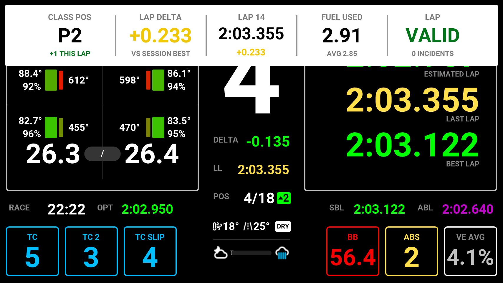

<!-- Made by scripts/Build-Readmes.ps1 from info.json and lmu-gt3.dashpro: change those, not this file -->
[← All presets](../../README.md)

# LMU GT3

For GT3 in Le Mans Ultimate, with separate race and qualifying layouts: a detailed Primary page for practice and the race, and a lighter Qualifying page focused on the hotlap. No top bar or sidebars.

| | |
| --- | --- |
| **Author** | Clive Melbourne |
| **Tags** | `LMU` `GT3` `16:9` |
| **Pages** | 2: Primary, Qualifying |
| **Added** | 2026-11-13 |
| **Updated** | 2026-11-13 |
| **Preset format** | v1 |

## Import
In the Lovely Plugin, open **Dash Pro**, click **Browse Presets**, pick **LMU GT3** and click **Import**.

Or download [lmu-gt3.dashpro](lmu-gt3.dashpro), then click **Import** at the top right of the Dash Pro page and choose the file.

Importing replaces the pages and layouts, the Lap Review and the Alerts & Notifications settings of the level you have selected: All Devices, a device, a sim, a class or a vehicle.

## Pages

### 1. Primary

| | |
| --- | --- |
| **Layout** | Modular |
| **Sessions** | Practice, Race |
| **Left modules** | Multifunction Modules (the pages set in the plugin) |
| **Right modules** | Multifunction Modules (the pages set in the plugin) |
| **Central column** | Delta, Last Lap, Position, Weather · sector bar |
| **Bottom left** | TC, TC 2, TC Slip |
| **Bottom right** | Brake Bias, ABS, VE Average |
| **Data row** | Time Remaining, Optimal Best Lap, Session Best, All-Time Best |

### 2. Qualifying

| | |
| --- | --- |
| **Layout** | Modular |
| **Sessions** | Qualifying |
| **Left modules** | 3 x 3: Estimated Lap / Tire Front Left / Tire Rear Left |
| **Right modules** | 3 x 3: Delta / Tire Front Right / Tire Rear Right |
| **Central column** | Speed, Last Lap, Position, Weather · sector bar |
| **Bottom left** | TC, TC 2, TC Slip |
| **Bottom right** | Brake Bias, ABS, VE Average |
| **Data row** | Time Remaining, Optimal Best Lap, Session Best, All-Time Best |

## Lap Review

| | |
| --- | --- |
| **Sessions** | Practice, Qualifying, Race |
| **Practice** | Strip 1-3-1: Position, Sector Deltas, Lap Time |
| **Qualifying** | Strip 1-1-1-1-1: Position, Lap Delta, Lap Time, Fuel Used, Lap Validity |
| **Race** | Strip 1-1-1-1-1: Position, Lap Delta, Lap Time, Fuel Used, Lap Validity |
| **Shows** | 3.5 s after each lap, normal colours |

## Alerts & Notifications
| Alert | Shown as |
| --- | --- |
| Vehicle Settings | Strip, normal colours, 1 s |
| Rotary Dials | Full Screen, normal colours |
| Pit Limiter | Small, normal colours |
| Engine & Ignition | Small, normal colours |
| Launch Mode | Off |
| Lift Now | Strip, normal colours |
| Fuel Warnings | Fuel blinks at 4 laps, LOW FUEL at 2 laps, PIT NOW |
| Engine Warnings | Water temperature (110°), oil temperature (130°), oil pressure, fuel pressure |
| Penalty | On |
| Flags | On |
| Damage | Strip, 4 s |

---

Screenshots: the 854x480 Lovely Dashboard Pro with sample race data (Le Mans Ultimate at Spa). Shared under [CC BY-NC-SA 4.0](https://creativecommons.org/licenses/by-nc-sa/4.0/).
