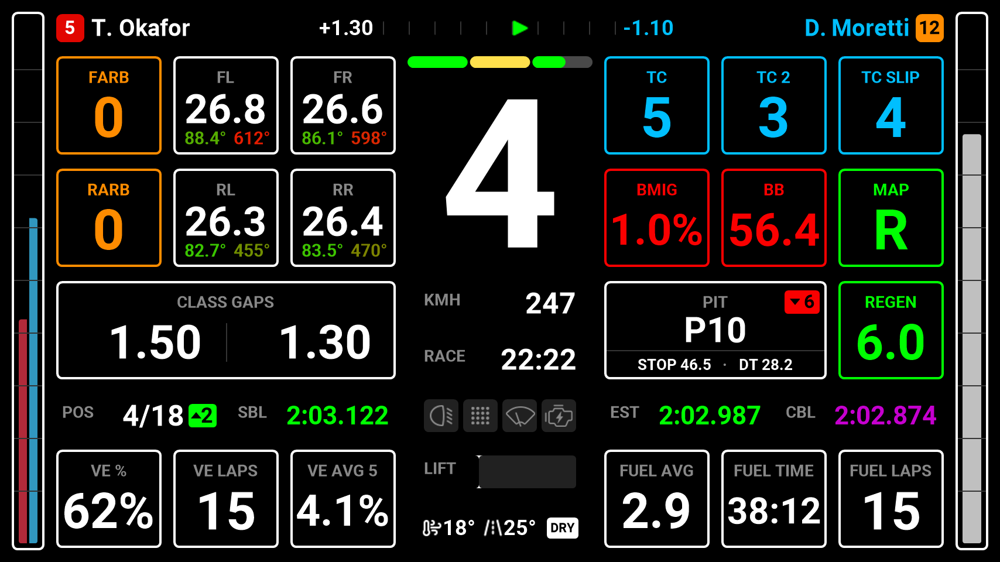
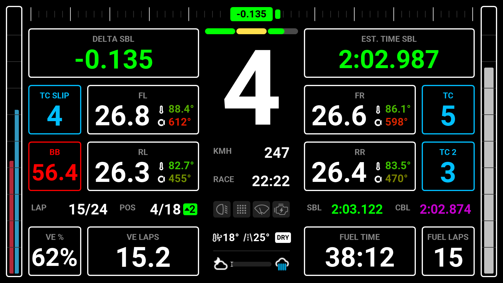
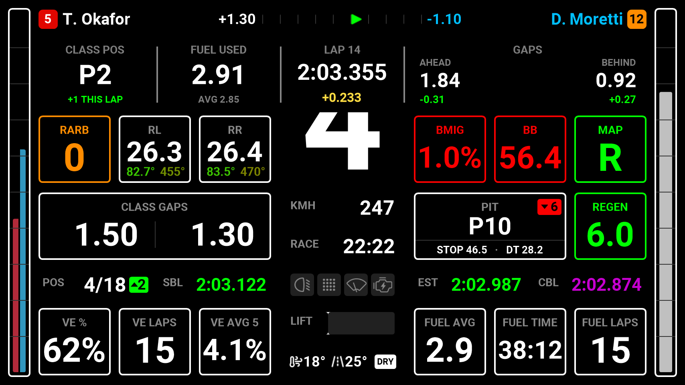

<!-- Made by scripts/Build-Readmes.ps1 from info.json and lmu-hyper.dashpro: change those, not this file -->
[← All presets](../../README.md)

# LMU Hyper

For Hypercar in Le Mans Ultimate, with a Primary page for practice and the race, with track gaps on top and the fuel, VE and battery sidebars, and a Quali page with the delta along the top and in a large module next to the estimated lap time.

| | |
| --- | --- |
| **Author** | Rontti |
| **Tags** | `LMU` `Hypercar` `16:9` |
| **Pages** | 2: Primary, Quali |
| **Added** | 2026-11-17 |
| **Updated** | 2026-11-17 |
| **Preset format** | v1 |

## Import
In the Lovely Plugin, open **Dash Pro**, click **Browse Presets**, pick **LMU Hyper** and click **Import**.

Or download [lmu-hyper.dashpro](lmu-hyper.dashpro), then click **Import** at the top right of the Dash Pro page and choose the file.

Importing replaces the pages and layouts, the Lap Review and the Alerts & Notifications settings of the level you have selected: All Devices, a device, a sim, a class or a vehicle.

## Pages

### 1. Primary

| | |
| --- | --- |
| **Layout** | Modular |
| **Sessions** | Practice, Race |
| **Topbar** | Track Gaps |
| **Sidebars** | Fuel / VE (left), SoC (right) |
| **Left modules** | 3 x 3: Front Roll Bar, Tire Front Left, Tire Front Right / Rear Roll Bar, Tire Rear Left, Tire Rear Right / Class Gaps |
| **Right modules** | 3 x 3: TC, TC 2, TC Slip / Brake Migration, Brake Bias, Engine Map / Pit Loss, Regen |
| **Central column** | Speed, Time Remaining, Functions, Lift & Coast, Weather · sector bar |
| **Bottom left** | VE %, VE Laps Left, VE 5 Lap Average |
| **Bottom right** | Fuel Average, Fuel Time Left, Fuel Laps Left |
| **Data row** | Position, Session Best, Estimated Lap, Class Session Best |

### 2. Quali

| | |
| --- | --- |
| **Layout** | Modular |
| **Sessions** | Practice, Qualifying |
| **Topbar** | Delta |
| **Sidebars** | Fuel / VE (left), SoC (right) |
| **Left modules** | 3 x 3: Delta / TC Slip, Tire Front Left / Brake Bias, Tire Rear Left |
| **Right modules** | 3 x 3: Estimated Lap / Tire Front Right, TC / Tire Rear Right, TC 2 |
| **Central column** | Speed, Time Remaining, Functions, Weather · sector bar |
| **Bottom left** | VE %, VE Laps Left |
| **Bottom right** | Fuel Time Left, Fuel Laps Left |
| **Data row** | Lap, Position, Session Best, Class Session Best |

## Lap Review

| | |
| --- | --- |
| **Sessions** | Practice, Qualifying, Race |
| **Practice** | Strip 1-1-1-2: Position, Fuel Used, Sectors, Lap Time |
| **Qualifying** | Strip 1-1-1-2: Position, Lap Time, Lap Delta, Sector Deltas |
| **Race** | Strip 1-1-1-2: Position, Fuel Used, Lap Time, Gaps |
| **Shows** | 3.5 s after each lap, inverted |

## Alerts & Notifications
| Alert | Shown as |
| --- | --- |
| Vehicle Settings | Strip, inverted, 1 s |
| Rotary Dials | Full Screen, normal colours |
| Pit Limiter | Small, normal colours |
| Engine & Ignition | Small, normal colours |
| Launch Mode | Off |
| Lift Now | Strip, normal colours |
| Fuel Warnings | Fuel blinks at 2 laps, PIT NOW |
| Engine Warnings | Water temperature (110°), oil temperature (130°), oil pressure, fuel pressure |
| Penalty | On |
| Flags | On |
| Damage | Block, 7.5 s |

---

Screenshots: the 854x480 Lovely Dashboard Pro with sample race data (Le Mans Ultimate at Spa). Shared under [CC BY-NC-SA 4.0](https://creativecommons.org/licenses/by-nc-sa/4.0/).
