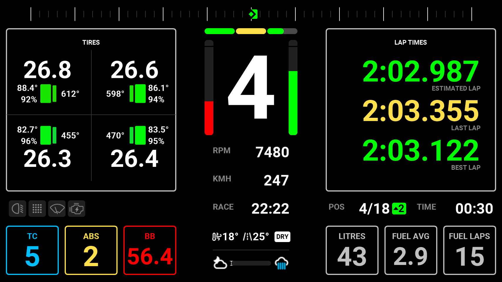
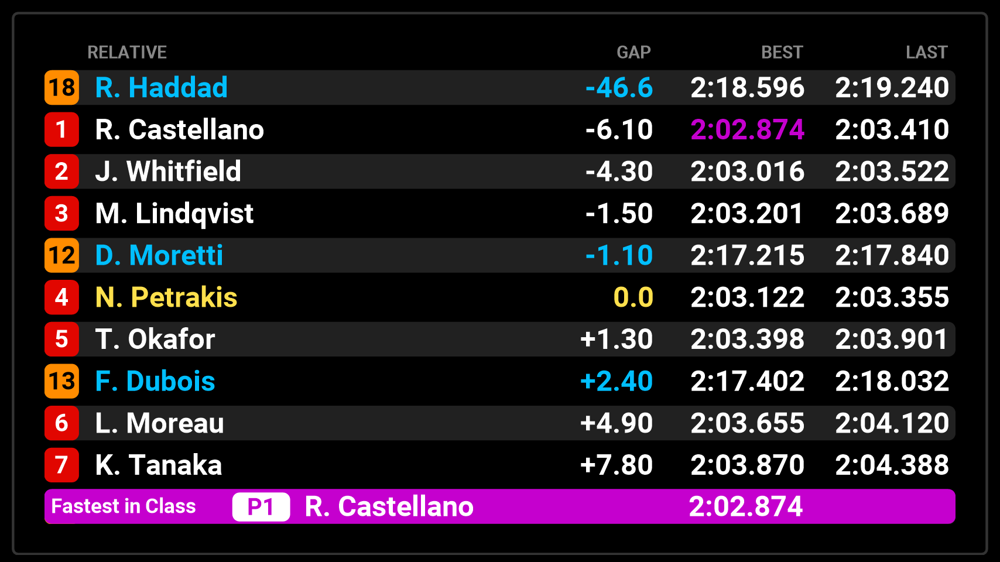
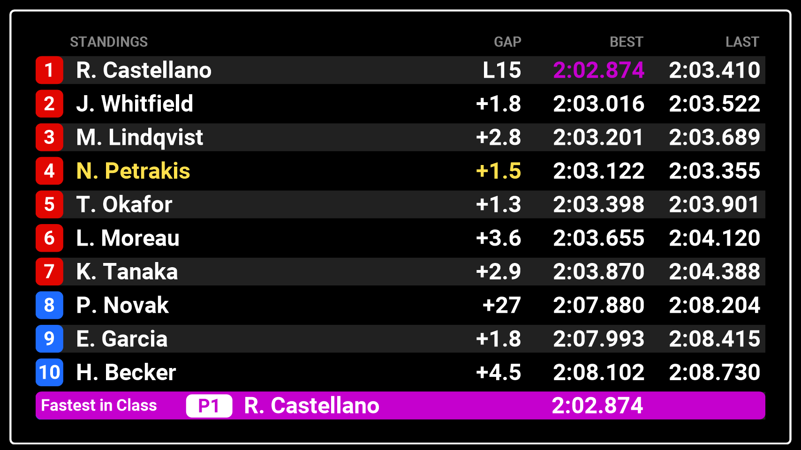
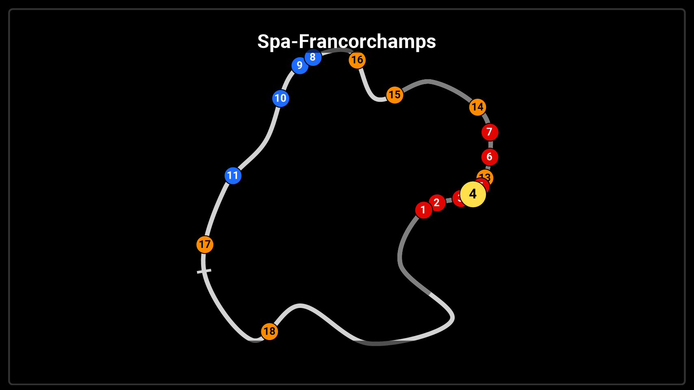
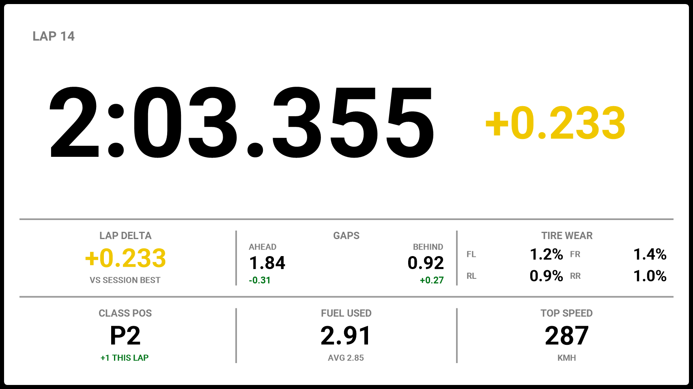

<!-- Made by scripts/Build-Readmes.ps1 from info.json and lovely-dashboard-classic.dashpro: change those, not this file -->
[← All presets](../../README.md)

# Lovely Dashboard Classic

The original Lovely Dashboard, reincarnated in Lovely Dashboard Pro.

| | |
| --- | --- |
| **Author** | Lovely Sim Racing |
| **Tags** | `Official` `Default` `Lovely Sim Racing` `Lovely Dashboard` `All Sims` `16:9` |
| **Pages** | 4: Primary, Relative, Standings, Map |
| **Added** | 2026-10-29 |
| **Updated** | 2026-10-29 |
| **Preset format** | v1 |

## Import
In the Lovely Plugin, open **Dash Pro**, click **Browse Presets**, pick **Lovely Dashboard Classic** and click **Import**.

Or download [lovely-dashboard-classic.dashpro](lovely-dashboard-classic.dashpro), then click **Import** at the top right of the Dash Pro page and choose the file.

Importing replaces the pages and layouts, the Lap Review and the Alerts & Notifications settings of the level you have selected: All Devices, a device, a sim, a class or a vehicle.

## Pages

### 1. Primary

| | |
| --- | --- |
| **Layout** | Modular |
| **Sessions** | Practice, Qualifying, Race |
| **Topbar** | Delta |
| **Left modules** | Multifunction Modules (the pages set in the plugin) |
| **Right modules** | Multifunction Modules (the pages set in the plugin) |
| **Central column** | RPM, Speed, Time Remaining, Weather · Inputs · sector bar |
| **Bottom left** | TC, ABS, Brake Bias |
| **Bottom right** | Fuel, Fuel Average, Fuel Laps Left |
| **Data row** | Functions, Position, Session Time |

### 2. Relative

| | |
| --- | --- |
| **Layout** | Full Screen: Relative |
| **Sessions** | Practice, Qualifying, Race |

### 3. Standings

| | |
| --- | --- |
| **Layout** | Full Screen: Standings |
| **Sessions** | Practice, Qualifying, Race |

### 4. Map

| | |
| --- | --- |
| **Layout** | Full Screen: Map Static |
| **Sessions** | Practice, Qualifying, Race |

## Lap Review

| | |
| --- | --- |
| **Sessions** | Practice, Qualifying, Race |
| **Layout** | Full Screen: Lap Delta, Gaps, Tire Wear / Position, Fuel Used, Top Speed |
| **Shows** | 3.5 s after each lap, normal colours |

## Alerts & Notifications
| Alert | Shown as |
| --- | --- |
| Vehicle Settings | Strip, normal colours, 1 s |
| Rotary Dials | Full Screen, normal colours |
| Pit Limiter | Small, normal colours |
| Engine & Ignition | Small, normal colours |
| Launch Mode | Off |
| Lift Now | Off |
| Fuel Warnings | Fuel blinks at 4 laps, LOW FUEL at 2 laps, PIT NOW |
| Engine Warnings | Water temperature (110°), oil temperature (130°), oil pressure, fuel pressure |
| Flags | On |
| Damage | Block, 7.5 s |

---

Screenshots: the 854x480 Lovely Dashboard Pro with sample race data (Le Mans Ultimate at Spa). Shared under [CC BY-NC-SA 4.0](https://creativecommons.org/licenses/by-nc-sa/4.0/).
