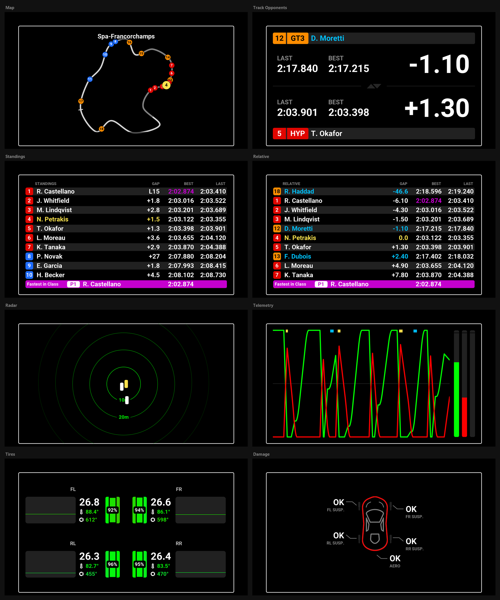
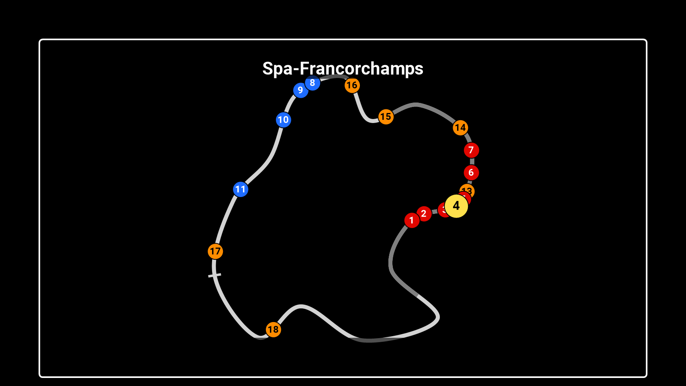
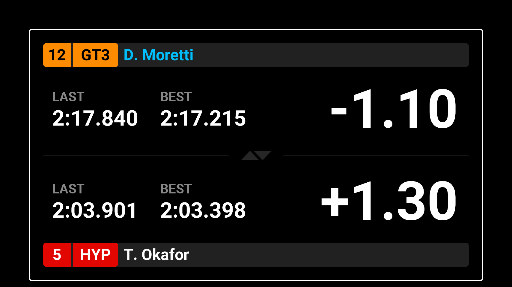
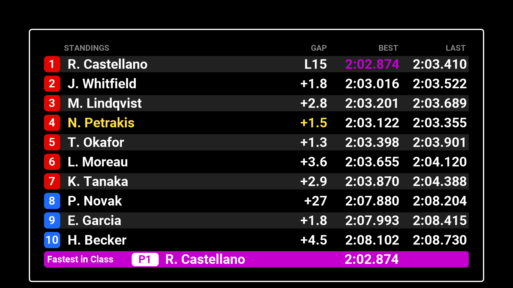
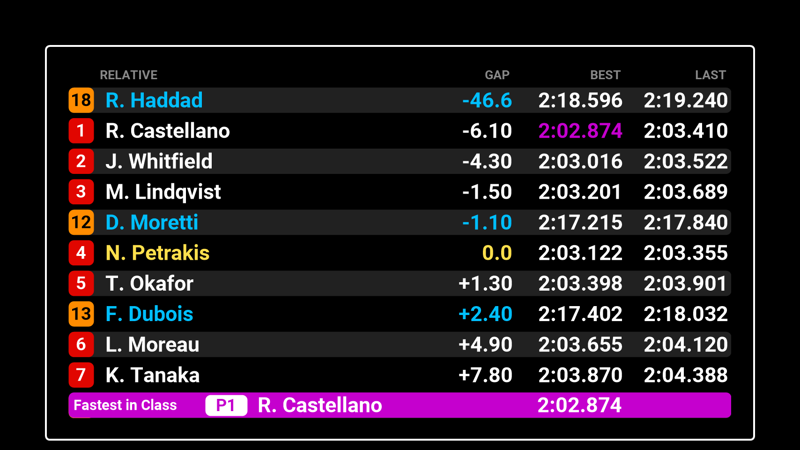
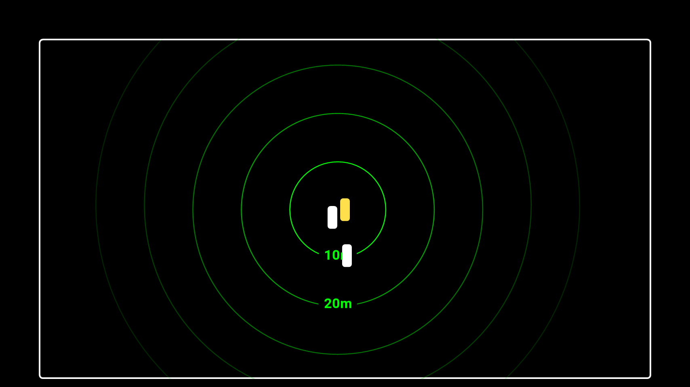
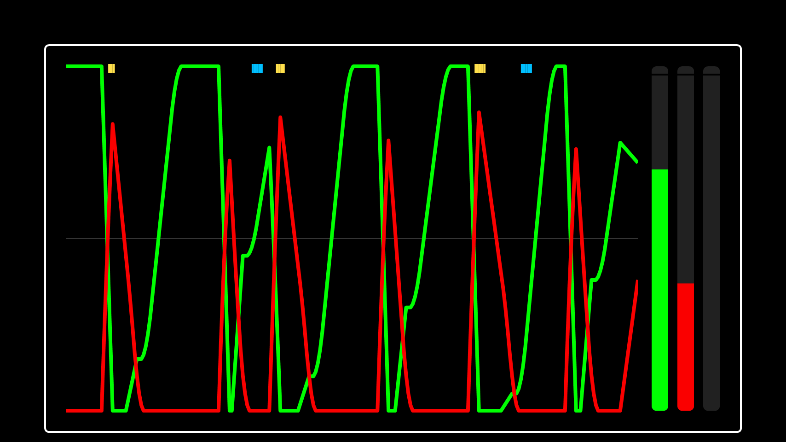
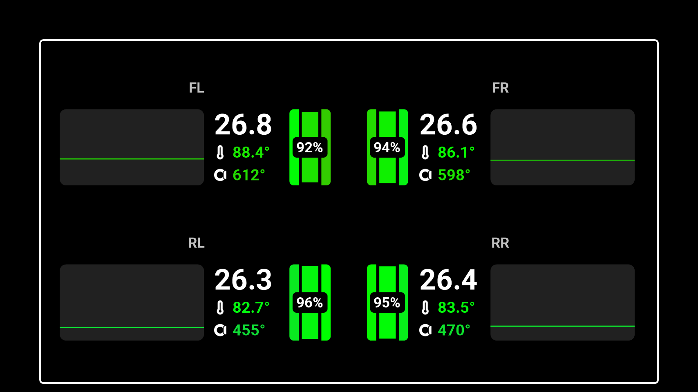
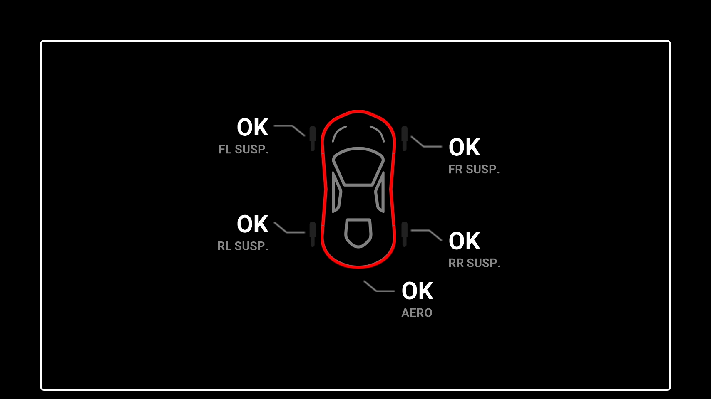

<!-- Made by scripts/Build-Readmes.ps1 from info.json and lovely-dashboard-companion.dashpro: change those, not this file -->
[← All presets](../../README.md)

# Lovely Dashboard Companion

The Lovely Dashboard Companion in Lovely Dashboard Pro: full screen map, track opponents, standings, relative, radar, telemetry, tyres and damage.

| | |
| --- | --- |
| **Author** | Lovely Sim Racing |
| **Tags** | `Official` `Default` `Lovely Sim Racing` `Lovely Dashboard` `All Sims` `16:9` |
| **Pages** | 8: Map, Track Opponents, Standings, Relative, Radar, Telemetry, Tires, Damage |
| **Added** | 2026-10-29 |
| **Updated** | 2026-10-29 |
| **Preset format** | v1 |

## Import
In the Lovely Plugin, open **Dash Pro**, click **Browse Presets**, pick **Lovely Dashboard Companion** and click **Import**.

Or download [lovely-dashboard-companion.dashpro](lovely-dashboard-companion.dashpro), then click **Import** at the top right of the Dash Pro page and choose the file.

Importing replaces the pages and layouts, the Lap Review and the Alerts & Notifications settings of the level you have selected: All Devices, a device, a sim, a class or a vehicle.

## Pages

### 1. Map

| | |
| --- | --- |
| **Layout** | Full Screen: Map Static |
| **Sessions** | Practice, Qualifying, Race |
| **Topbar** | Next Race |

### 2. Track Opponents

| | |
| --- | --- |
| **Layout** | Full Screen: Track Opponents |
| **Sessions** | Practice, Qualifying, Race |
| **Topbar** | Next Race |

### 3. Standings

| | |
| --- | --- |
| **Layout** | Full Screen: Standings |
| **Sessions** | Practice, Qualifying, Race |
| **Topbar** | Next Race |

### 4. Relative

| | |
| --- | --- |
| **Layout** | Full Screen: Relative |
| **Sessions** | Practice, Qualifying, Race |
| **Topbar** | Next Race |

### 5. Radar

| | |
| --- | --- |
| **Layout** | Full Screen: Radar |
| **Sessions** | Practice, Qualifying, Race |
| **Topbar** | Next Race |

### 6. Telemetry

| | |
| --- | --- |
| **Layout** | Full Screen: Telemetry |
| **Sessions** | Practice, Qualifying, Race |
| **Topbar** | Next Race |

### 7. Tires

| | |
| --- | --- |
| **Layout** | Full Screen: Tire Info |
| **Sessions** | Practice, Qualifying, Race |
| **Topbar** | Next Race |

### 8. Damage

| | |
| --- | --- |
| **Layout** | Full Screen: Damage |
| **Sessions** | Practice, Qualifying, Race |
| **Topbar** | Next Race |

## Lap Review
Off in every session.

## Alerts & Notifications
| Alert | Shown as |
| --- | --- |
| Vehicle Settings | Off |
| Rotary Dials | Full Screen, inverted |
| Pit Limiter | Off |
| Engine & Ignition | Off |
| Launch Mode | Off |
| Lift Now | Off |
| Fuel Warnings | Off |
| Engine Warnings | Off |
| Flags | Off |
| Damage | Off |

---

Screenshots: the 854x480 Lovely Dashboard Pro with sample race data (Le Mans Ultimate at Spa). Shared under [CC BY-NC-SA 4.0](https://creativecommons.org/licenses/by-nc-sa/4.0/).
