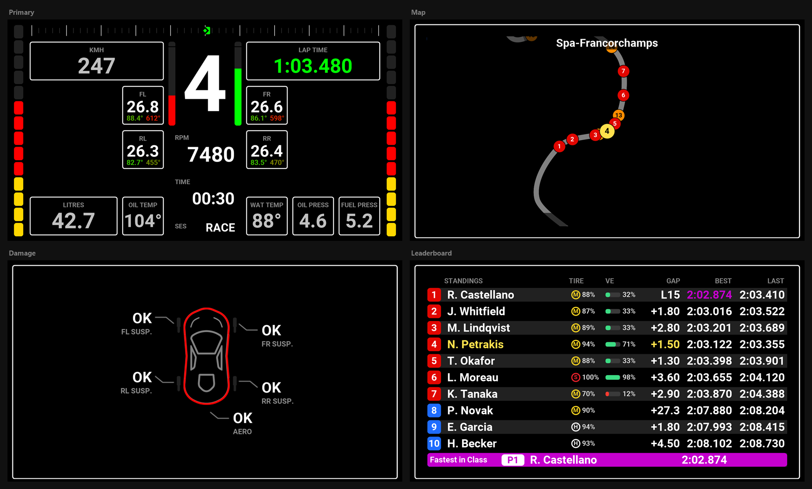
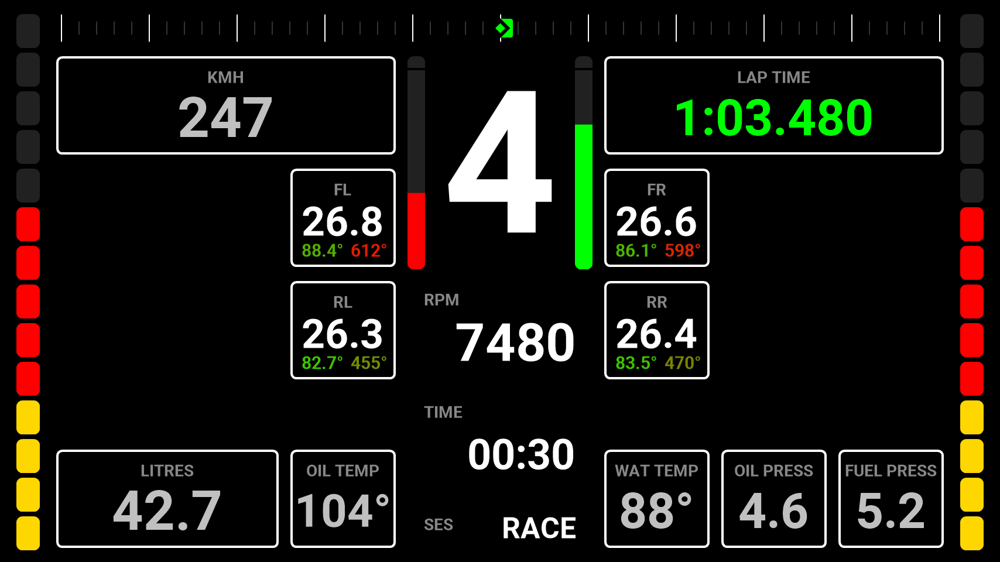
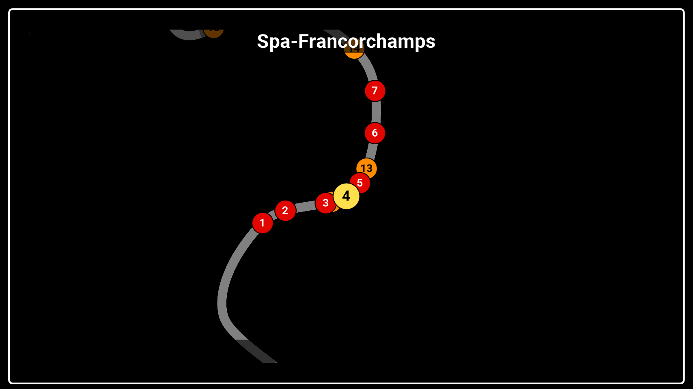
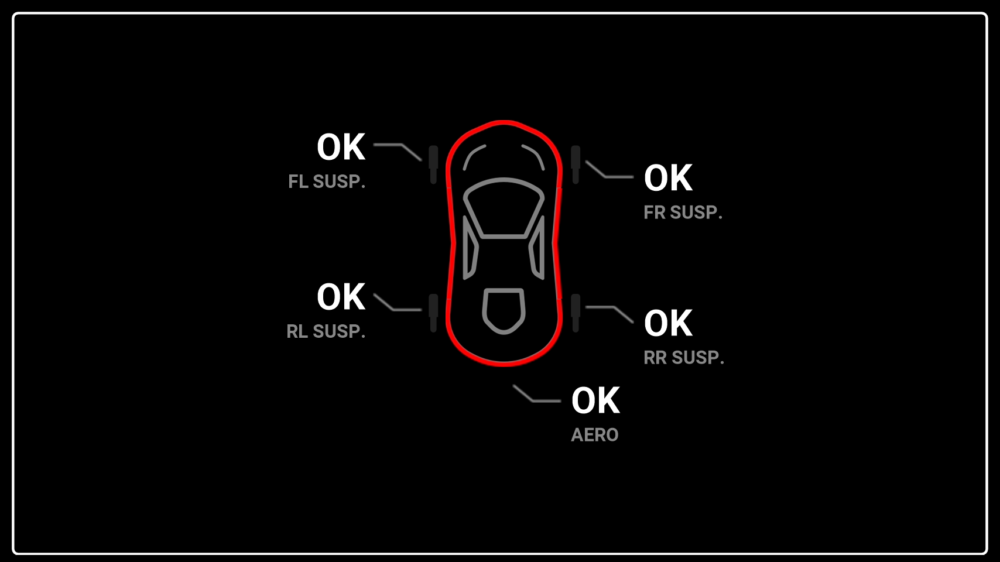
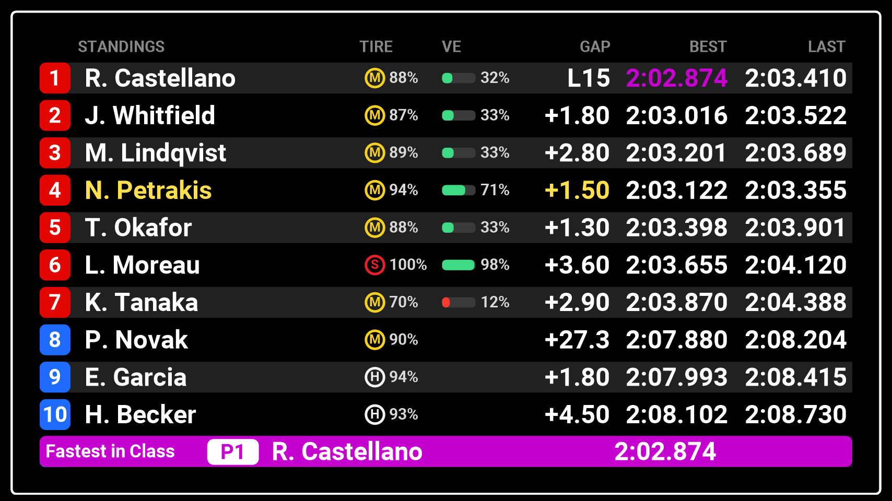

<!-- Made by scripts/Build-Readmes.ps1 from info.json and rallye-dash.dashpro: change those, not this file -->
[← All presets](../../README.md)

# Rallye Dash

A rally dash: one main page with gear, speed, RPM, session and lap time, the four tyres and the engine's temperatures and pressures, plus a full screen zoomed-in track map, damage and standings. Both sidebars are Virtual RPM shift lights.

| | |
| --- | --- |
| **Author** | Lovely Sim Racing |
| **Tags** | `Official` `Rallye` `16:9` `Rally` |
| **Pages** | 4: Primary, Map, Damage, Leaderboard |
| **Added** | 2026-11-11 |
| **Updated** | 2026-11-12 |
| **Preset format** | v1 |

## Import
In the Lovely Plugin, open **Dash Pro**, click **Browse Presets**, pick **Rallye Dash** and click **Import**.

Or download [rallye-dash.dashpro](rallye-dash.dashpro), then click **Import** at the top right of the Dash Pro page and choose the file.

Importing replaces the pages and layouts, the Lap Review and the Alerts & Notifications settings of the level you have selected: All Devices, a device, a sim, a class or a vehicle.

## Pages

### 1. Primary

| | |
| --- | --- |
| **Layout** | Modular |
| **Sessions** | Practice, Qualifying, Race |
| **Topbar** | Delta |
| **Sidebars** | Virtual RPM (left), Virtual RPM (right) |
| **Left modules** | 3 x 3: Speed / Tire Front Left / Tire Rear Left |
| **Right modules** | 3 x 3: Current Lap / Tire Front Right / Tire Rear Right |
| **Central column** | RPM, Session Time, Session Name · Inputs |
| **Bottom left** | Fuel, Oil Temp |
| **Bottom right** | Water Temp, Oil Pressure, Fuel Pressure |

### 2. Map

| | |
| --- | --- |
| **Layout** | Full Screen: Map Animated |
| **Sessions** | Practice, Qualifying, Race |

### 3. Damage

| | |
| --- | --- |
| **Layout** | Full Screen: Damage |
| **Sessions** | Practice, Qualifying, Race |

### 4. Leaderboard

| | |
| --- | --- |
| **Layout** | Full Screen: Standings |
| **Sessions** | Practice, Qualifying, Race |

## Lap Review
Off in every session.

## Alerts & Notifications
| Alert | Shown as |
| --- | --- |
| Vehicle Settings | Full Screen, inverted, 1 s |
| Rotary Dials | Full Screen, normal colours |
| Pit Limiter | Small, normal colours |
| Engine & Ignition | Small, normal colours |
| Launch Mode | Off |
| Lift Now | Strip, normal colours |
| Fuel Warnings | Fuel blinks at 4 laps, LOW FUEL at 2 laps, PIT NOW |
| Engine Warnings | Water temperature (110°), oil temperature (130°), oil pressure, fuel pressure |
| Penalty | On |
| Flags | On |
| Damage | Strip, 7.5 s |

---

Screenshots: the 854x480 Lovely Dashboard Pro with sample race data (Le Mans Ultimate at Spa). Shared under [CC BY-NC-SA 4.0](https://creativecommons.org/licenses/by-nc-sa/4.0/).
