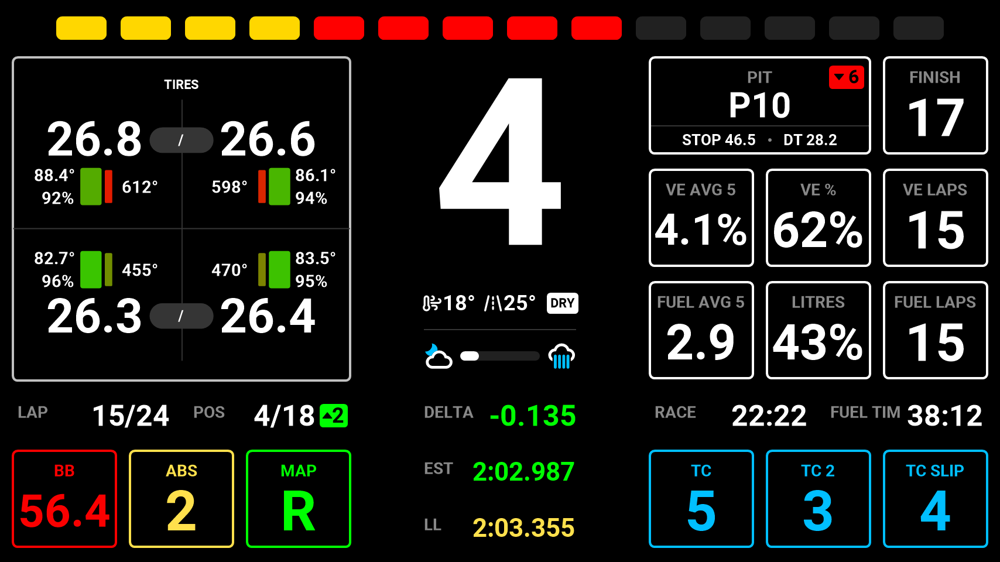
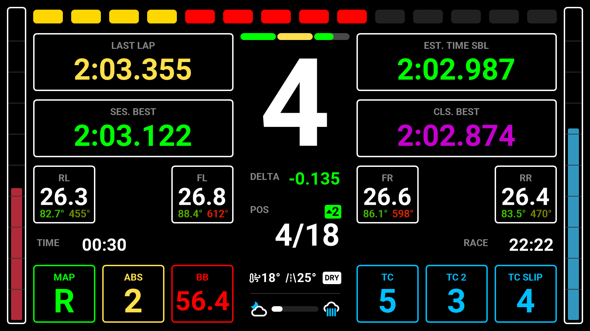
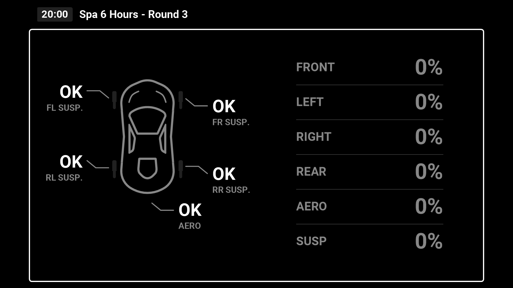
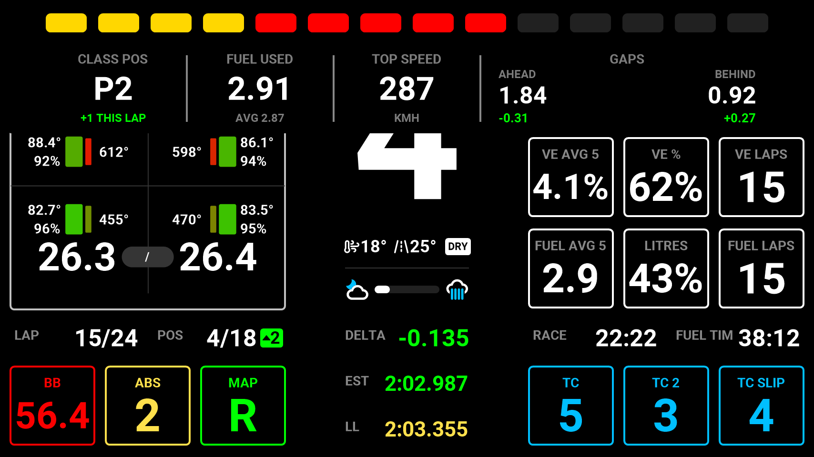

<!-- Made by scripts/Build-Readmes.ps1 from info.json and simple-gt3.dashpro: change those, not this file -->
[← All presets](../../README.md)

# Simple GT3

A simple GT3 layout for Le Mans Ultimate. The Primary page for practice and the race has large tire modules on the left and fuel, VE and the pit stop on the right. The Quali page shows lap times, time remaining and tire temperatures, and a full screen Damage page completes the set.

| | |
| --- | --- |
| **Author** | JRG Racing |
| **Tags** | `LMU` `GT3` `16:9` |
| **Pages** | 3: Primary, Quali, Damage |
| **Added** | 2026-11-20 |
| **Updated** | 2026-11-20 |
| **Preset format** | v1 |

## Import
In the Lovely Plugin, open **Dash Pro**, click **Browse Presets**, pick **Simple GT3** and click **Import**.

Or download [simple-gt3.dashpro](simple-gt3.dashpro), then click **Import** at the top right of the Dash Pro page and choose the file.

Importing replaces the pages and layouts, the Lap Review and the Alerts & Notifications settings of the level you have selected: All Devices, a device, a sim, a class or a vehicle.

## Pages

### 1. Primary

| | |
| --- | --- |
| **Layout** | Modular |
| **Sessions** | Practice, Race |
| **Topbar** | Virtual RPM |
| **Left modules** | Multifunction Modules (the pages set in the plugin) |
| **Right modules** | 3 x 3: Pit Loss, Refuel / VE 5 Lap Average, VE %, VE Laps Left / Fuel 5 Lap Average, Fuel %, Fuel Laps Left |
| **Central column** | Weather, Delta, Estimated Lap, Last Lap |
| **Bottom left** | Brake Bias, ABS, Engine Map |
| **Bottom right** | TC, TC 2, TC Slip |
| **Data row** | Lap, Position, Time Remaining, Fuel Time Left |

### 2. Quali

| | |
| --- | --- |
| **Layout** | Modular |
| **Sessions** | Practice, Qualifying |
| **Topbar** | Virtual RPM |
| **Sidebars** | Fuel (left), Virtual Energy (right) |
| **Left modules** | 3 x 3: Last Lap / Session Best / Tire Rear Left, Tire Front Left |
| **Right modules** | 3 x 3: Estimated Lap / Class Session Best / Tire Front Right, Tire Rear Right |
| **Central column** | Delta, Position, Weather · sector bar |
| **Bottom left** | Engine Map, ABS, Brake Bias |
| **Bottom right** | TC, TC 2, TC Slip |
| **Data row** | Session Time, Time Remaining |

### 3. Damage

| | |
| --- | --- |
| **Layout** | Full Screen: Damage |
| **Sessions** | Practice, Race |
| **Topbar** | Next Race |

## Lap Review

| | |
| --- | --- |
| **Sessions** | Practice, Qualifying, Race |
| **Practice** | Strip 1-1-1-2: Position, Lap Time, Lap Delta, Sector Deltas |
| **Qualifying** | Strip 1-1-1-2: Position, Lap Time, Lap Delta, Sector Deltas |
| **Race** | Strip 1-1-1-2: Position, Fuel Used, Top Speed, Gaps |
| **Shows** | 3.5 s after each lap, inverted |

## Alerts & Notifications
| Alert | Shown as |
| --- | --- |
| Vehicle Settings | Strip, inverted, 1 s |
| Rotary Dials | Full Screen, normal colours |
| Pit Limiter | Small, normal colours |
| Engine & Ignition | Small, normal colours |
| Launch Mode | Off |
| Lift Now | Strip, normal colours |
| Fuel Warnings | Fuel blinks at 4 laps, LOW FUEL at 2 laps, PIT NOW |
| Engine Warnings | Water temperature (110°), oil temperature (130°), oil pressure, fuel pressure |
| Penalty | On |
| Flags | On |
| Damage | Strip, 7.5 s |

---

Screenshots: the 854x480 Lovely Dashboard Pro with sample race data (Le Mans Ultimate at Spa). Shared under [CC BY-NC-SA 4.0](https://creativecommons.org/licenses/by-nc-sa/4.0/).
