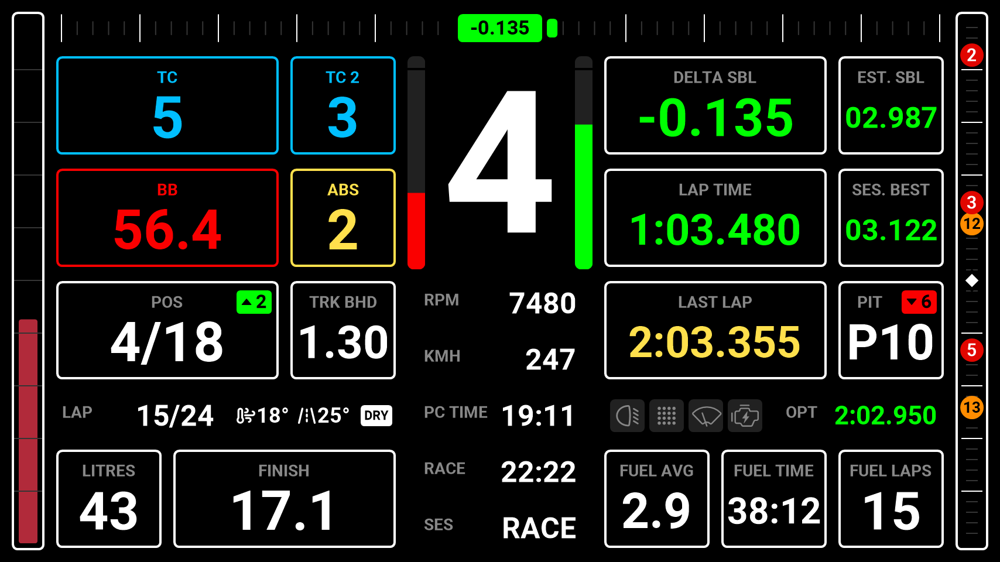
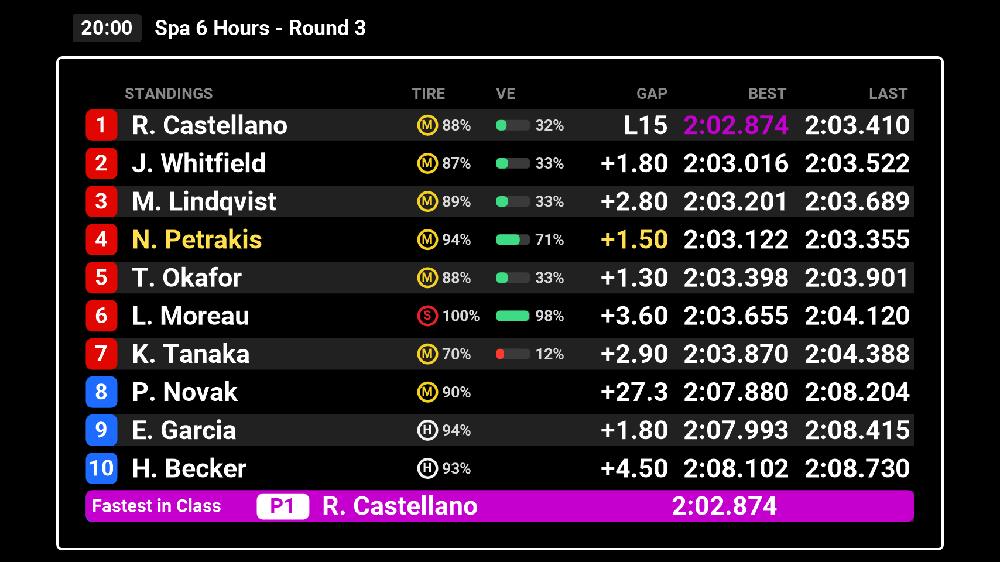
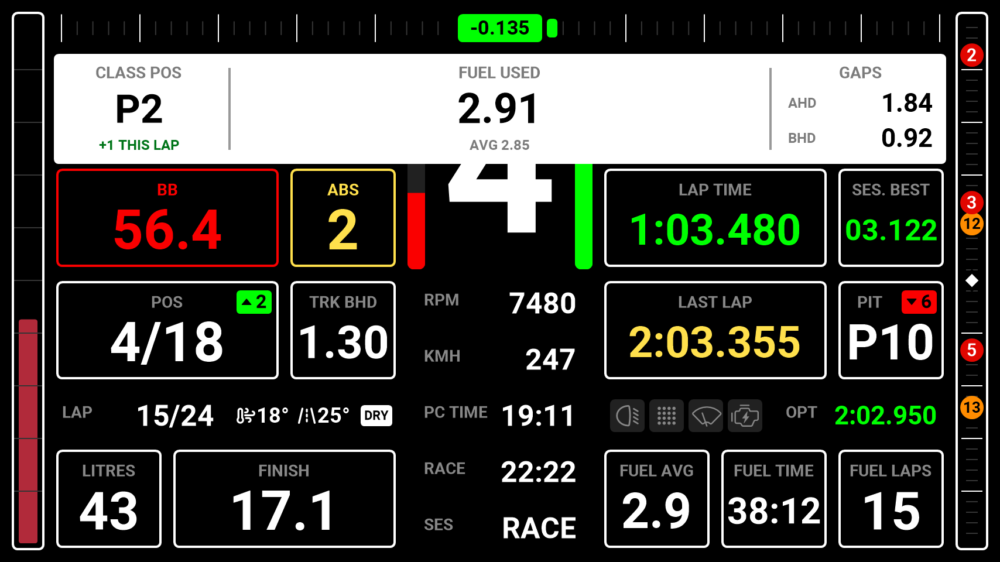

<!-- Made by scripts/Build-Readmes.ps1 from info.json and thaus0n-iracing.dashpro: change those, not this file -->
[← All presets](../../README.md)

# Thaus0n iRacing

For iRacing, with one layout for every session: TC, ABS and brake bias on the left, the delta and lap times on the right, fuel along the bottom and the PC clock in the centre, plus a full screen leaderboard for practice and the race.

| | |
| --- | --- |
| **Author** | Thaus0n |
| **Tags** | `iRacing` `16:9` |
| **Pages** | 3: Practice & Quali, Race, Leaderboard |
| **Added** | 2026-11-19 |
| **Updated** | 2026-11-19 |
| **Preset format** | v1 |

## Import
In the Lovely Plugin, open **Dash Pro**, click **Browse Presets**, pick **Thaus0n iRacing** and click **Import**.

Or download [thaus0n-iracing.dashpro](thaus0n-iracing.dashpro), then click **Import** at the top right of the Dash Pro page and choose the file.

Importing replaces the pages and layouts, the Lap Review and the Alerts & Notifications settings of the level you have selected: All Devices, a device, a sim, a class or a vehicle.

## Pages

### 1. Practice & Quali

| | |
| --- | --- |
| **Layout** | Modular |
| **Sessions** | Practice, Qualifying |
| **Topbar** | Delta |
| **Sidebars** | Fuel (left), Linear Map (right) |
| **Left modules** | 3 x 3: TC, TC 2 / Brake Bias, ABS / Position, Track Behind |
| **Right modules** | 3 x 3: Delta, Estimated Lap / Current Lap, Session Best / Last Lap, Pit Loss |
| **Central column** | RPM, Speed, PC Time, Time Remaining, Session Name · Inputs |
| **Bottom left** | Fuel, Refuel |
| **Bottom right** | Fuel Average, Fuel Time Left, Fuel Laps Left |
| **Data row** | Lap, Weather, Functions, Optimal Best Lap |

### 2. Race

| | |
| --- | --- |
| **Layout** | Modular |
| **Sessions** | Race |
| **Topbar** | Delta |
| **Sidebars** | Fuel (left), Linear Map (right) |
| **Left modules** | 3 x 3: TC, TC 2 / Brake Bias, ABS / Position, Track Behind |
| **Right modules** | 3 x 3: Delta, Estimated Lap / Current Lap, Session Best / Last Lap, Pit Loss |
| **Central column** | RPM, Speed, PC Time, Time Remaining, Session Name · Inputs |
| **Bottom left** | Fuel, Refuel |
| **Bottom right** | Fuel Average, Fuel Time Left, Fuel Laps Left |
| **Data row** | Lap, Weather, Functions, Optimal Best Lap |

### 3. Leaderboard

| | |
| --- | --- |
| **Layout** | Full Screen: Standings |
| **Sessions** | Practice, Race |
| **Topbar** | Next Race |

## Lap Review

| | |
| --- | --- |
| **Sessions** | Race |
| **Layout** | Strip 1-3-1: Position, Fuel Used, Gaps |
| **Shows** | 3.5 s after each lap, normal colours |

## Alerts & Notifications
| Alert | Shown as |
| --- | --- |
| Vehicle Settings | Strip, normal colours, 1 s |
| Rotary Dials | Full Screen, normal colours |
| Pit Limiter | Small, normal colours |
| Engine & Ignition | Small, normal colours |
| Launch Mode | Off |
| Lift Now | Strip, normal colours |
| Fuel Warnings | Fuel blinks at 4 laps, LOW FUEL at 2 laps, PIT NOW |
| Engine Warnings | Water temperature (110°), oil temperature (130°), oil pressure, fuel pressure |
| Penalty | On |
| Flags | On |
| Damage | Block, 7.5 s |

---

Screenshots: the 854x480 Lovely Dashboard Pro with sample race data (Le Mans Ultimate at Spa). Shared under [CC BY-NC-SA 4.0](https://creativecommons.org/licenses/by-nc-sa/4.0/).
